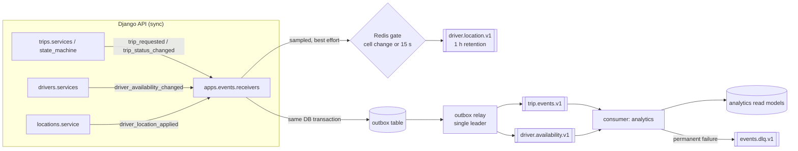

# Event Streaming with Kafka (Step 5)

Kafka distributes **facts that already happened** to other parts of the system:
analytics today, and matching, notifications and fraud detection later. It is
**not** a source of truth. Trips, payments, users, driver profiles and
availability live in PostgreSQL. If Kafka lost every message, no trip or payment
record would change. Only downstream projections (`apps.analytics`) would need
rebuilding, and they can be rebuilt from PostgreSQL.

## Synchronous vs asynchronous

| Operation | Mode | Path | Outcome if Kafka is down |
|---|---|---|---|
| Register / login / me | sync | HTTP → PostgreSQL | unaffected |
| Request / cancel trip | sync | HTTP → PostgreSQL transaction (trip + payment record + **outbox row**) | unaffected; event waits in the outbox |
| Driver online/offline | sync | HTTP → PostgreSQL transaction (status + **outbox row**) → Redis mirror | unaffected; event waits in the outbox |
| GPS location update | sync | HTTP → Redis (Lua) | unaffected |
| Nearby drivers / candidates | sync | HTTP → Redis + PostgreSQL | unaffected |
| Publish trip and availability events | **async** | outbox relay process → Kafka (`trip.events.v1`, `driver.availability.v1`) | rows stay `PENDING`, retried with backoff, published in order once Kafka returns |
| Publish sampled location events | **async, best effort** | request thread → Redis gate → non-blocking producer queue → `driver.location.v1` | dropped (`events.location.dropped`); the GPS update itself succeeds |
| Analytics projections (trip timeline, driver daily stats) | **async** | `run_event_consumer analytics` | stale until Kafka returns, then catches up |

No HTTP request ever waits on Kafka. The only Kafka call inside a request is a
non-blocking `produce()` into a bounded local queue, for sampled location events.

## Architecture



Business code never imports Kafka or the events app. It sends Django **signals**
(`apps/*/signals.py`) synchronously inside its own transaction.
`apps/events/receivers.py` turns them into versioned events
(`apps/events/builders.py`). Only `apps/events/kafka.py` imports
`confluent_kafka`.

## Events and topics

All schemas are v1. Generated JSON Schemas are in
[`events/schemas.v1.json`](events/schemas.v1.json), and the source is
`apps/events/schemas.py`.

| Event | Topic | Key | Emitted by | Path |
|---|---|---|---|---|
| `DriverLocationUpdated` | `driver.location.v1` | `driver_id` | location update, sampled | direct, best effort |
| `DriverAvailabilityChanged` | `driver.availability.v1` | `driver_id` | `drivers.services._apply_status` (API toggle, auto-offline) | outbox |
| `RideRequested` | `trip.events.v1` | `trip_id` | `trips.services.request_trip` | outbox |
| `RideOfferCreated` | `trip.events.v1` | `trip_id` | builder ready; emitted by the matching step | outbox |
| `RideAccepted` | `trip.events.v1` | `trip_id` | builder ready; emitted by the offer-acceptance step | outbox |
| `TripStatusChanged` | `trip.events.v1` | `trip_id` | every `state_machine.transition` | outbox |
| `TripCompleted` | `trip.events.v1` | `trip_id` | transition to `COMPLETED` (after its `TripStatusChanged`) | outbox |

**Keys and ordering.** Every event about one trip, from `RideRequested` through
offers, acceptance and status changes to `TripCompleted`, goes to **one topic
keyed by `trip_id`**. They therefore land in one partition and stay in order;
the integration test asserts this. Driver events are keyed by `driver_id`.

**Envelope:**

```json
{"event_id": "uuid", "event_type": "TripStatusChanged", "event_version": 1,
 "occurred_at": "…+00:00", "producer": "ride-hailing-backend", "key": "<trip_id>",
 "payload": {…}}
```

Kafka headers repeat `event_type`, `event_version`, `event_id` and
`content_type`. Money is sent as decimal **strings** (floats are rejected),
timestamps are ISO-8601 UTC, and payloads contain ids only: no names, emails or
phone numbers.

**Versioning:**
- **Additive change** (a new optional field): bump `event_version`; consumers
  ignore unknown fields.
- **Breaking change:** a new version that consumers must handle, or a new topic
  (`…v2`) run side by side.
- **Unknown versions** are dead-lettered, never guessed at.

## Volume and retention

| Topic | Partitions | Retention | Cleanup | Volume |
|---|---|---|---|---|
| `driver.location.v1` | 6 | **1 hour** | delete | ≤ 1 event per driver per 15 s, plus one per H3 cell change. Stale positions are worthless, so retention is short. |
| `driver.availability.v1` | 3 | 7 days | **compact**, delete | a few per driver per shift; compaction keeps the latest state per driver for bootstrapping consumers |
| `trip.events.v1` | 6 | 7 days | delete | about 3–8 per trip |
| `events.dlq.v1` | 3 | 14 days | delete | should be ~0; every message is an alert |

**GPS volume control.** Drivers ping every few seconds, but `DriverLocationUpdated`
is published only when the driver's H3 cell changed or 15 s passed
(`LOCATION_EVENT_MIN_INTERVAL_SECONDS`). One atomic Redis script decides, shared
across all API processes.

In the local test, 6 pings produced 2 events. For a driver pinging every 4 s,
that is about a 4× reduction: at most one event per ~15 s instead of one per 4 s.
At city speeds a res-8 cell (~0.5 km) changes every 20–40 s, so cell changes add
little on top of the interval events.

No consumer group subscribes to the location topic by default (see
`apps/events/registry.py`): high-frequency data is opt-in. Anything needing the
*current* position reads the Redis hot store, not Kafka.

Topics are created by `manage.py ensure_kafka_topics` (idempotent; the relay and
consumer containers run it on start). Broker auto-creation is **disabled**, so a
typo cannot silently create a topic with default retention.

## Transactional outbox

1. **Write.** The business transaction inserts an `events_outboxevent` row in
   the same transaction as the change (`apps/events/outbox.py`). If the
   transaction rolls back, the event never existed. Calling `enqueue()` outside a
   transaction raises an error.
2. **Publish.** `run_outbox_relay` (a separate process) loops:
   - takes `pg_try_advisory_xact_lock`, so **only one relay is active**; extra
     replicas idle as hot standbys;
   - reads `PENDING` rows in id order and publishes them with an idempotent
     producer (`enable.idempotence`, `acks=all`);
   - marks the delivered rows `PUBLISHED`.
3. **Failures.** On the first failure the batch stops. The failed row gets
   exponential backoff (1 s doubling, capped at 60 s), and **nothing after it is
   published** until it succeeds. This head-of-line blocking preserves per-key
   order. After `OUTBOX_MAX_ATTEMPTS` (50, about 45 minutes) the row becomes
   `FAILED`, an error is logged and `events.outbox.gave_up` is emitted, so one
   poison event can't block the stream forever.
4. **At-least-once.** A relay crash after Kafka acknowledged a message but
   before the row was marked republishes the same `event_id`; consumers dedupe
   (tested).
5. **Cleanup.** `prune_event_tables` (daily) deletes published rows after 7 days.

## Consumers: idempotency, retries, DLQ

`EventProcessor` (in `apps/events/consumer.py`) processes each message like this:

1. **Decode and validate.** If the envelope or schema is invalid, or the version
   is unknown → **DLQ immediately**.
2. **Handler lookup.** If the group has no handler for this `event_type` →
   `IGNORED` and committed.
3. **Duplicate check.** If `(consumer_group, event_id)` already exists in
   `ProcessedEvent` → `DUPLICATE` and committed.
4. **Handle.** In one PostgreSQL transaction: insert the `ProcessedEvent` row,
   then run the handler. If two deliveries race, the unique constraint turns the
   second into `DUPLICATE`.
5. **Failure handling:**

| Failure | Handling |
|---|---|
| `PermanentError` raised by the handler | DLQ immediately |
| Any other handler exception | retry `CONSUMER_MAX_RETRIES` (4) times, backoff 0.5 s doubling up to 8 s, then DLQ |
| PostgreSQL down (`OperationalError` / `InterfaceError`) or DLQ unreachable | **not** dead-lettered: offset not committed, seek back, pause 5 s, retry. An outage must not dump the stream into the DLQ. |

6. **Commit.** The offset is committed **only after** the message is handled,
   found to be a duplicate, ignored or dead-lettered (`enable.auto.commit=false`).

A failed attempt rolls back its partial side effects together with the ledger
row (tested). The analytics handlers increment counters and are deliberately
*not* idempotent on their own; the ledger is what makes redelivery safe.
`PROCESSED_EVENT_RETENTION_DAYS` (14) is longer than the longest topic retention
(7 days), so any redelivery is still recognised.

**DLQ messages** keep the original key, value and headers and add
`dlq_original_topic/partition/offset`, `dlq_consumer_group`, `dlq_error_class`,
`dlq_error`, `dlq_attempts` and `dlq_failed_at`. To redrive them, fix the bug,
then re-produce the DLQ message values to the original topic. That is safe
because the event ids are unchanged and consumers dedupe.

## Monitoring and health

| Where | What |
|---|---|
| `GET /api/v1/health/` (public) | `events.status`, Kafka reachability, outbox `pending` / `failed` / `oldest_pending_age_s`. Kafka trouble yields `degraded` with **HTTP 200**: the API keeps serving and events wait in the outbox. |
| `GET /api/v1/health/events/` (staff only) | Everything above, plus per consumer group: **per-partition lag** (committed vs high watermark), total lag, instance heartbeats (alive if seen within 60 s). Problems: `kafka_unreachable`, `outbox_backlog` (oldest > 60 s), `outbox_failed_events`, `consumer_down:<g>`, `consumer_lag:<g>` (> 1000). |
| `make events-status` | the same report as JSON, for operators |

Metrics:

| Metric | Type / notes |
|---|---|
| `events.outbox.enqueued` / `published` / `publish_failed` / `gave_up` | counters |
| `events.outbox.pending` / `oldest_pending_age_s` | gauges |
| `events.consumer.handled` / `duplicate` / `retry` / `dead_lettered` / `ignored` / `infrastructure_error` | counters |
| `events.consumer.lag{group}` | gauge |
| `events.location.published` / `sampled_out` / `dropped` / `gate_unavailable` | counters |
| `events.produce.delivered` / `failed` / `dropped` | counters |

## Verified locally (docker compose)

- **Topics.** Created with the configured partitions, retention and compaction
  (checked with `kafka-topics.sh --describe`).
- **Happy path.** A driver went online, sent 6 GPS pings, a rider requested and
  cancelled a trip. Outbox rows went `PUBLISHED`; Kafka held 2 location events,
  1 availability event and 2 trip events. The analytics consumer wrote the
  timeline (`REQUESTED → CANCELLED`) and driver stats, with lag 0.
- **Kafka stopped:**
  - Availability, location and trip API calls returned 200 in 12–43 ms.
  - Health showed `degraded` / `kafka_unreachable` with HTTP 200.
  - 4 events waited in the outbox while the relay logged
    `publish_failed … _MSG_TIMED_OUT` and backed off.
- **Kafka started again.** The outbox drained in about 9 s and the consumer
  caught up. All 7 events were processed once (7 ledger rows, 7 distinct ids).
  The first run took about 30 s for the consumer to reconnect; after tightening
  `reconnect.backoff.max.ms` / `socket.connection.setup.timeout.ms`, the event
  reached the read model **5 s after `docker compose start kafka`**, broker boot
  included.
- **Consumer stopped.** 6 availability events accumulated as total lag 6 in
  `event_pipeline_status`. After restart lag returned to 0 and the projection
  counts were exact.

## Operations

| Command | When |
|---|---|
| `make topics` | deploy (also runs automatically on relay/consumer start) |
| `make relay` / `make consume` | long-lived processes (Compose services `outbox-relay`, `consumer-analytics`) |
| `make events-status` | on-call: backlog, lag, heartbeats |
| `make prune-events` | daily: published outbox rows, old dedupe records, dead heartbeats |

**Rebuilding analytics.**
- From Kafka: truncate `analytics_*` and that group's `ProcessedEvent` rows, then
  reset the group's offsets to earliest. This only covers events still within
  7-day retention.
- For full history: recompute from the PostgreSQL trip tables, which are
  authoritative.

## Known limitations

- **Single broker.** Replication factor 1 and no auth/TLS locally. Production
  needs at least 3 brokers, `replication.factor=3`, `min.insync.replicas=2`,
  SASL/TLS and ACLs.
- **Retries block the partition.** In-consumer retries hold up that partition
  for up to about 8 s (0.5 + 1 + 2 + 4 s of backoff). Non-blocking retry topics are a possible later
  improvement.
- **Slow offset commits.** Commits are synchronous per message: simple and safe,
  but limited to a few hundred messages per second per consumer. Batch commits
  come when throughput requires them.
- **Two events are not emitted yet.** `RideOfferCreated` and `RideAccepted` have
  schemas, builders and tests, but no domain code emits them until matching
  exists.
- **No schema registry.** JSON plus in-repo schemas is sufficient for one
  producer service. Move to Avro/Protobuf with a registry when more teams
  produce.
